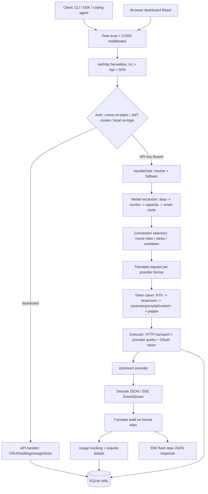

# 01 — Analisis Arsitektur dan Execution Flow

Dokumen ini memetakan arsitektur berdasarkan implementasi aktual. Klaim yang tidak dapat dibuktikan dari kode ditandai `BELUM DIVERIFIKASI`.

## 1. Arsitektur KineRouter (terverifikasi)

### Tahapan yang terverifikasi satu per satu

| Tahap | Bukti di KineRouter | Status |
|---|---|---|
| HTTP server | `cmd/kinerouter/main.go:109-115` — `http.Server`, `ReadHeaderTimeout`, tanpa `WriteTimeout` | TERVERIFIKASI |
| Middleware | `internal/gateway/gateway.go:102-106` — `withPeerTrust`, `withCORS`, `withRequestLog`. `withPeerTrust` membuang header forwarding dari peer non-loopback (`gateway.go:250-270`) | TERVERIFIKASI |
| Autentikasi dashboard | `gateway.go:295-319` — CLI token, JWT, atau `requireLogin=false` + loopback | TERVERIFIKASI |
| Autentikasi `/v1` | `handleChat` memvalidasi `Authorization`/`x-api-key`; detail ada di `chat.go` | TERVERIFIKASI, detail audit batch 3 |
| Request validation | `decodeBody` + `maxBody=128 MiB` (`gateway.go:67`) | TERVERIFIKASI |
| Model resolution | alias chain, combo, capacity adapter, smart route di `chat.go`/`smartroute.go`/`capacity.go` | TERVERIFIKASI |
| Provider resolution | `providerdata.Registry` + provider node dari store | TERVERIFIKASI |
| Account selection | `rrPick`/`rrConfig`, sticky session, cooldown | TERVERIFIKASI |
| Routing engine | fallback akun → combo; fusion panel + judge; capacity-based reorder | TERVERIFIKASI |
| Provider adapter | `internal/executor/*` (openai generic + 41 custom executor/quirks) | TERVERIFIKASI |
| Upstream request | `executor.Do` memakai `*http.Client` dengan `http.Transport`; proxy resolver dipasang `gateway.New` (`gateway.go:72-77`) | TERVERIFIKASI |
| Response translation | `internal/translate/*`, termasuk SSE stateful translators | TERVERIFIKASI |
| Streaming / non-streaming | `streamTranslate` di `chat.go` menulis `data:` + `[DONE]`; non-stream folded | TERVERIFIKASI |
| Usage tracking | `store.RecordUsage`/`requestDetails` dipanggil dari jalur chat; tabel di `store/schema.go:70-102` | TERVERIFIKASI |
| Logging | `logAt` ke stderr + `logbuf`; request log via `statusWriter` | TERVERIFIKASI |
| Graceful shutdown | `gw.Shutdown()` sebelum `srv.Shutdown(ctx 10s)` (`main.go:163-169`) | TERVERIFIKASI |

### Modul yang tadinya tidak terintegrasi (sudah diperbaiki sebelum sesi audit ini)

- `GET /api/settings` tidak mengirim `enableTranslator`/`enableRequestLogs`; halaman Translator tidak bisa muncul meski env diset. Perbaikan: `applyEnvCapabilityFlags` di `handlers.go`.
- Setting outbound proxy tersimpan tetapi tidak dipakai executor. Perbaikan: `outboundproxy.go` + `Executor.SetProxyFunc` + pemasangan di `Gateway.New`.
- Strategi combo diubah tetapi rotasi lama tidak di-reset. Perbaikan: `resetComboRotation("")` di PATCH settings.
- Registry `apiKeyOptionalWith` tidak di-parse. Perbaikan: field di `providerdata.Entry` + `apiKeyOptional` di `connections.go`.

### Modul yang masih perlu diverifikasi lebih dalam

- `claudeAutoPing`/`codexAutoPing`: field tersimpan tetapi scheduler belum ditemukan di KineRouter (klaim `IMPLEMENTATION.md` tidak menyebut fitur ini). Status: **TIDAK DITEMUKAN / perlu audit batch 5**.
- `connectionNoProxy` kini tersimpan di `providerSpecificData`, tetapi pemakaiannya di transport per-akun belum dibuktikan. Status: **SEBAGIAN SESUAI**.
- `globalPriority`: tidak ada kolom di schema v2. Status: **TIDAK DITEMUKAN**, butuh keputusan migrasi skema.
- Aksi OAuth sidecar (`start-proxy`, `poll-status`, `stop-proxy`, `ide-status`, `register-session`, `manual-code`) jatuh ke fallback 404. Status: **TIDAK DIIMPLEMENTASIKAN** sesuai keputusan desain, perlu didokumentasikan sebagai kontrak 400 vs 404.

### Potensi masalah struktural yang sudah terlihat

1. `Gateway.New` memanggil `executor.New()` yang membuat satu `*http.Client` bersama. Dengan proxy resolver global, proxy per-akun tidak bisa berbeda per request tanpa mengubah transport. (`gateway.go:56-78`, `executor/executor.go`).
2. `Store` dibuka satu koneksi SQLite; pola WAL/busy timeout perlu dibaca di `internal/store/store.go` untuk menilai konkurensi. (batch 2).
3. `Gateway.outboundProxy atomic.Value` menyimpan snapshot config, tetapi `Executor.transport.Proxy` diubah sekali saat init. Jika `refreshOutboundProxy` mengganti fungsi setelah request berjalan, ini melanggar kontrak `http.Transport.Proxy` — perlu dibaca `outboundproxy.go` untuk memastikan tidak terjadi (batch 5).
4. `withRequestLog` mengukur durasi stream sampai klien selesai; ini disengaja, tetapi `statusWriter.Flush` hanya meneruskan `Flush()` bila writer mendukungnya (sudah ada).

## 2. Arsitektur 9Router original (terverifikasi sebagian)

Referensi utama adalah Next.js. Bukti yang sudah dibaca langsung:

- `package.json`: `next start` lewat `custom-server.js --port 20127`.
- `custom-server.js`: membungkus `http.createServer`, menghapus header `x-9r-real-ip`, `x-forwarded-for`, `x-9r-via-proxy`, `x-9r-peer-token` dari klien, lalu menstamp `x-9r-real-ip` dari TCP peer (atau proxy loopback) dan `x-9r-peer-token` dari secret per-proses; juga menangani h2c downgrade dan start background token refresh.
- `src/lib/db/schema.js`: `SCHEMA_VERSION = 2`, PRAGMA WAL/synchronous NORMAL/temp_store MEMORY/mmap/cache/foreign_keys/busy_timeout 5000, 11 tabel pertama identik dengan `kine/internal/store/schema.go` (10 tabel + `_meta`).
- Rute berada di `src/app/api/**/route.js`; UI React di `src/app/dashboard/**` dan `src/components/**`.

Perbedaan mendasar: Next.js menjalankan SSR/API route dalam satu proses Node; KineRouter menggantinya dengan satu binary Go + SPA statis. Artinya setiap perilaku yang bergantung pada `process.env`, `next/headers`, cookies Next, atau middleware Node harus dicari padanan eksplisitnya di Go — tidak otomatis tersedia.

## 3. Arsitektur 9router-go (dari `ARCHITECTURE.md`, commit `de05f24`)

- Proses Go tunggal + SPA Svelte 5 yang di-embed.
- Uber Fx mengelola lifecycle: config → database/repository → handler/server; `OnStart` 15 detik, `OnStop` 20 detik.
- Chi router dengan norm路径 `/v1/` berulang; grup middleware: public, engine (`RequireApiKey`), dashboard management (`RequireDashboardAuth`), admin (`RequireAdminAuth`).
- Body limit global 10 MiB; panic recovery; request ID; log terstruktur.
- SQLite WAL, `EnsureCoreSchema` additive untuk 11 tabel upstream + tabel Go-only `upstream_leases`; tidak ada legacy JSON import/backup.
- CLI `urfave/cli`, daemon detach, doctor, `healthyAt` probe terbaru di commit yang diaudit.
- Dashboard Svelte bukan source-compatible dengan React KineRouter, tetapi kontrak API yang dipertahankan penting untuk paritas.

## 4. Perbedaan utama ketiga repository

| Aspek | 9Router original | KineRouter | 9router-go |
|---|---|---|---|
| Runtime | Node + Next.js 16 | Go 1.27 binary + React embedded | Go 1.27 binary + Svelte embedded |
| Router | Next route files + custom server | `net/http.ServeMux` pattern-based | Chi + path normalization |
| Body limit | Next default (bukan 128 MiB) | 128 MiB (`gateway.go:67`) | 10 MiB |
| Auth engine | Next middleware + custom peer token | CLI token / JWT / loopback | `RequireApiKey`, `RequireDashboardAuth`, `RequireAdminAuth` terpisah |
| DB | sql.js/better-sqlite3, migrator + backup | modernc SQLite, schema v2 additive | modernc SQLite WAL + EnsureCoreSchema |
| Dashboard | React SSR | React Vite statis | Svelte 5 |
| Baseline | v0.5.123 | 0.2.5 | v0.5.85 |
| Konfigurasi | `process.env` langsung | env sekali saat `config.Load`, sebagian dibaca saat handler | Viper + env |

## 5. Bagian yang sudah sesuai

- Skema DB v2 dan path `DATA_DIR/db/data.sqlite` identik dengan referensi (`store/schema.go`, `config/config.go:62`).
- Peer-IP trust: KineRouter membuang XFF/X-Real-IP dari peer non-loopback, sama seperti `custom-server.js` (`gateway.go:250-270`).
- Tanpa `WriteTimeout` pada server, sehingga stream panjang tidak dipotong oleh HTTP server.
- Rute `/v1` utama dan dashboard API mencakup permukaan yang disebut di `IMPLEMENTATION.md`; inventaris rute nyata ada di `gateway.go:108-243`.
- Pola three-tier fallback, rotation, sticky session, kapasitas, dan fusion benar-benar memiliki implementasi di dalam paket `gateway` (bukan hanya nama file).

## 6. Bagian yang belum sesuai / berisiko

| Temuan | Dampak | Status |
|---|---|---|
| Upstream referensi sudah v0.5.123; KineRouter 0.2.5 dan 9router-go baseline v0.5.85 | Fitur baru upstream (ElevenLabs TTS models, REA prompt, Kiro CreateResponse fallback, Antigravity Hydrogen, dll.) belum tentu ada di KineRouter | RISIKO TINGGI |
| Body limit 128 MiB vs 10 MiB di 9router-go | Permukaan DoS lebih besar, dan kontrak error 413 bisa beda | PERLU AUDIT |
| Proxy resolver per-request belum mendukung proxy per-akun | `connectionNoProxy`/`proxyPoolId` bisa tersimpan tetapi tidak dipakai saat request | SEBAGIAN SESUAI |
| Envelope respons `/exchange`, `/keys/{id}`, DELETE keys berbeda dengan 9Router | Klien yang diport verbatim dari referensi bisa membaca `undefined` | PERLU KEPUTUSAN |
| Auto-ping quota scheduler belum ditemukan | Jadwal yang disimpan dashboard tidak pernah berjalan | TIDAK DITEMUKAN |
| Sidecar OAuth tidak diport | Endpoint 404, bukan 400 eksplisit seperti yang diklaim `IMPLEMENTATION.md` untuk web-session | DOKUMENTASI/KONTRAK |

## 7. Rencana audit file per file

Masih sesuai 10 batch di `AUDIT/00_INVENTARIS_REPOSITORY.md` bagian 10. Untuk setiap file, format wajib dari permintaan dipakai: identitas file, referensi 9Router, referensi 9router-go, analisis fungsi, analisis perbedaan, temuan, rekomendasi, status, prioritas, verifikasi. File tanpa pasangan referensi tetap diaudit berdasarkan kontrak internalnya.

## 8. Verifikasi yang tersedia pada perangkat ini

Tidak ada terminal, `go`, `npm`, atau build server di perangkat. Satu-satunya verifikasi otomatis yang dapat dipakai adalah CI GitHub (`.github/workflows/kine-ci.yml`) setelah perubahan di-push; pada sesi ini belum ada push. Semua status `TERVERIFIKASI` di dokumen ini berarti "dibuktikan oleh pembacaan kode", bukan "build/test berhasil".
